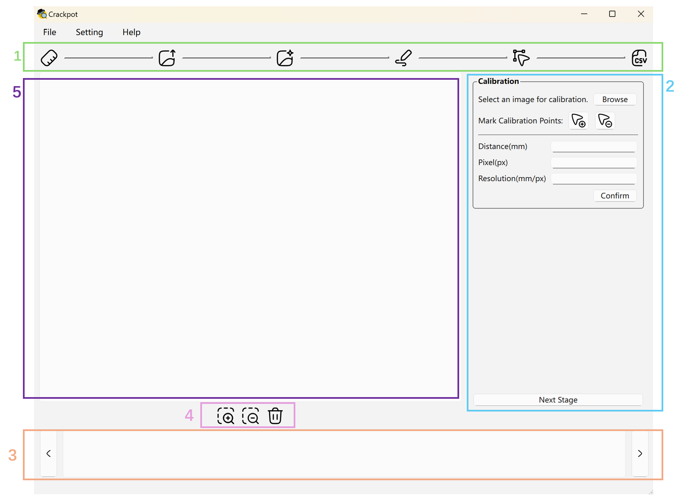
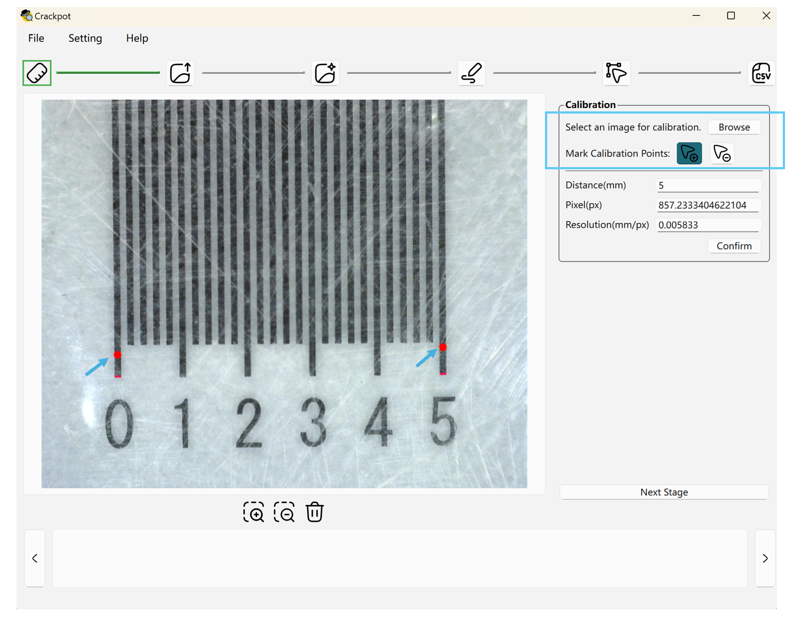
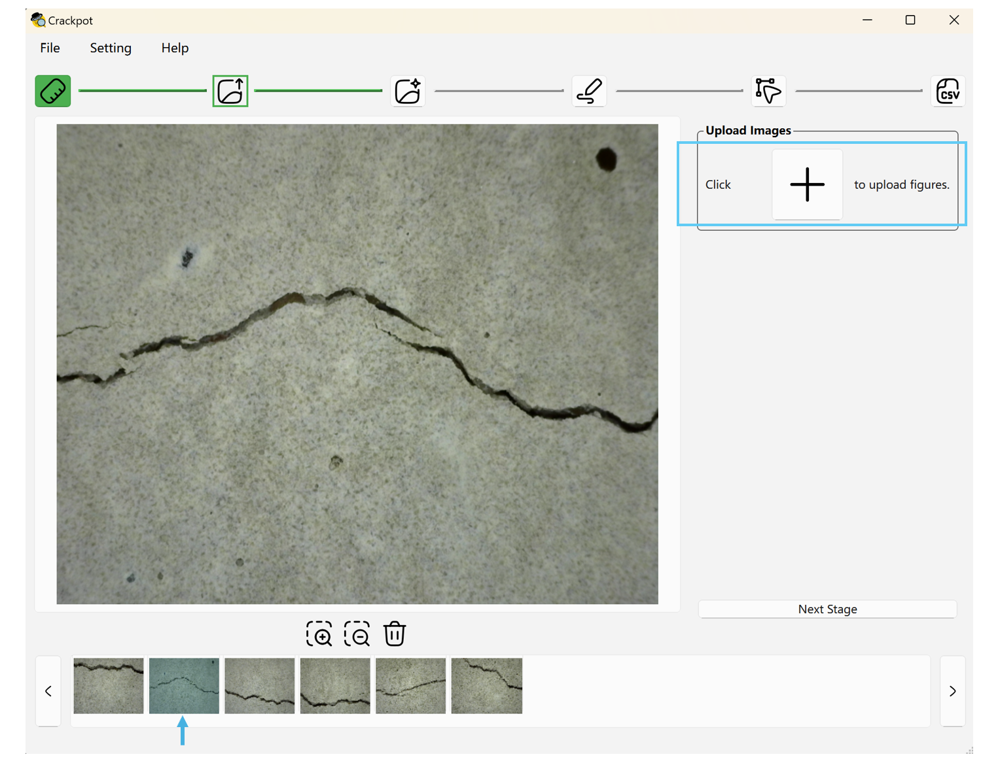
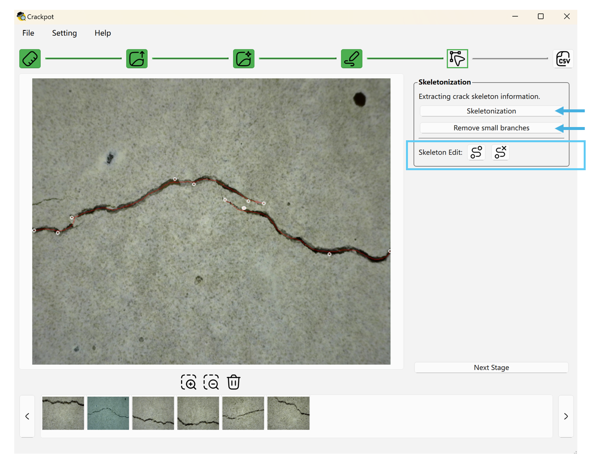
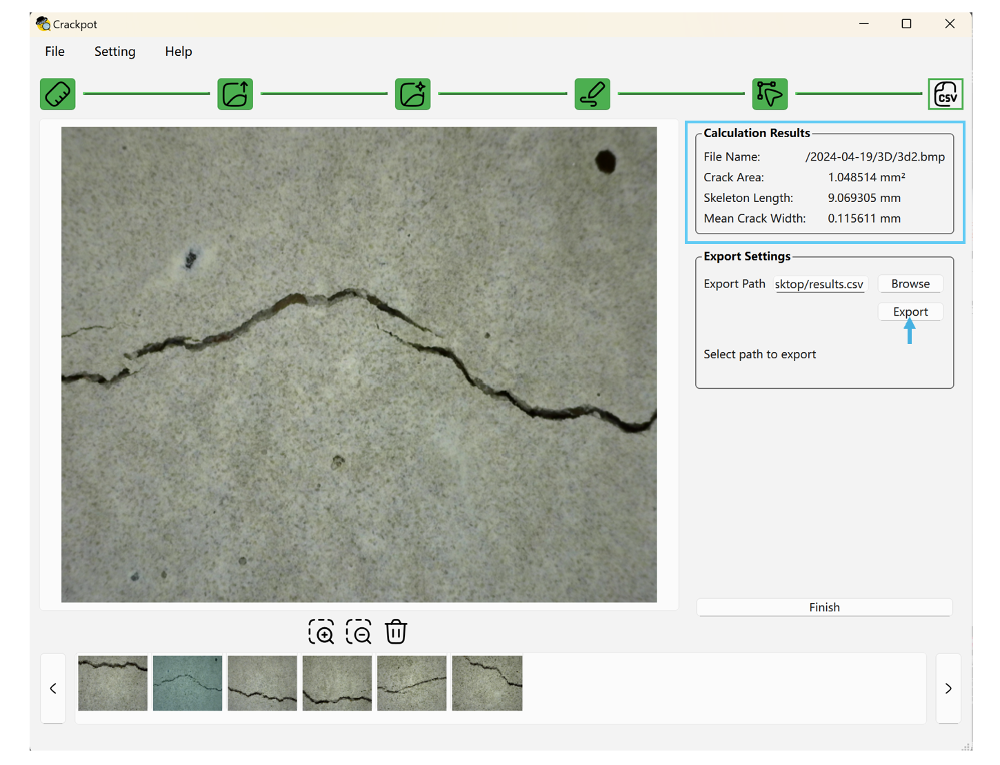

# Crackpot – Concrete Research And Crack Knowledge Photogrammetric Observation Tool

## Introduction

This projects aims to automatically extract the crack properties from photographs of cracks.
It supports batch processing of images through several stages, 
mainly focusing on crack region detection, crack skeleton extraction, and mean crack width calculation based on calibrated resolution.
Manual edit tools are available at specific stages where refinement of the automated results is necessary.

The workflow consists of the following stages:
- [Calibration Stage](#calibration-stage)
- [Image Upload Stage](#image-upload-stage)
- [Masking Stage](#masking-stage)
- [Skeleton Extraction Stage](#skeleton-extraction-stage)
- [Results Export Stage](#results-export-stage)

## Interface Structure

The user interface consists of five main parts:

1. **Top Workflow Status Bar**: Displays the current stage within the workflow.
Five icons correspond to the five stages described earlier.
   - White icons represent incomplete stages.
   - Green icons indicate completed stages.
   - A green-bordered icon highlights the current active stage.

2. **Right-Side Tool Panel**: Provides the available tools and operations for each stage.

3. **Bottom Thumbnail Browser**: Displays thumbnails of all loaded images.
The main image can be switched by clicking on a thumbnail or by using the left and right navigation buttons.

4. **Center Toolbar for Image Actions**: Offers tools for zooming in, zooming out, fitting the image to the visible area, resetting the view to its native 1:1 resolution, and deleting the currently displayed image.
   - **Fit to Window** (`Ctrl+0`): scales the image so that it fits completely into the visible area while keeping its aspect ratio.
   - **1:1** (`Ctrl+1`): shows the image at its native resolution, where one image pixel corresponds to one screen pixel, which is useful for pixel-accurate inspection and annotation.
   - **Scroll to zoom**: hold `Ctrl` and scroll the mouse wheel or trackpad over the image to zoom in and out around the image center.

5. **Main Image Display and Editing Area**: The central area of the interface is used to displaying and editing the selected image.

> The UI icons are sourced from [Huge Icons](https://icon-sets.iconify.design/hugeicons/), 
and are licensed under the [MIT License](./src/resources/license/icon_MIT_LICENSE.txt).

## Calibration Stage

This stage calculates the resolution (millimeters per pixel) required for subsequent analysis.
If the resolution is already known, it can be directly entered into the resolution field and confirmed.
Otherwise, the resolution can be calibrated by uploading an image (such as a ruler or reference object).

If image-based calibration is used, a calibration point selection tool is available in the tool panel on the right side.
By selecting two points on the uploaded image, the software will automatically calculate the number of pixels between the selected points.
After entering the actual physical distance corresponding to these points, the resolution will be computed automatically.

> When uploading an image, please ensure that the file path does not contain special characters such as `ü`, `ö`, `ä`, etc., as this may cause upload errors.

## Image Upload Stage

In this stage, images intended for analysis can be uploaded in batches.
After uploading, all images will appear as thumbnails in the browser at the bottom of the interface.
Clicking on a thumbnail will display the corresponding full-size image in the main viewing area.

> When uploading an image, please ensure that the file path does not contain special characters such as `ü`, `ö`, `ä`, etc., as this may cause upload errors.

## Masking Stage

This stage combines automatic crack detection and manual mask editing, since detection results
often need manual refinement anyway. Every uploaded image starts out with an empty, directly
editable crack mask; a model can optionally be applied on top of that.

**Model selection and detection:**

- Choose a detection method from the dropdown menu — **Concrete Crack Segmentation** (default) uses the model
  from [Concrete Crack Segmentation](https://github.com/Subham2901/Concrete_Crack_Segmentation), which is licensed
  under the [MIT License](./src/resources/license/model_MIT_LICENSE.txt); **None** keeps the mask empty for
  fully manual annotation.
- **Apply model**: runs the selected detection method and overwrites the current mask with the result.
  Available as two buttons: **This Image** applies it only to the currently displayed image, **All Images**
  applies it to every uploaded image (batch processing). With **None** selected, this resets the mask to
  empty instead of running a model.
- **Clear mask**: resets the mask back to empty, so it can be rebuilt manually. Also available for **This Image**
  or **All Images**.

**Manual editing tools**, for refining the mask (automatically detected or hand-drawn) by hand:

- Brush: Add Brush & Delete Brush
- Brush Size
- Brush Shape: Round (default) & Square
- Opacity Slider: Allow adjusting the transparency to compare between the original image (0%) and the crack mask (100%).
- **Remove patches smaller than (px)**: removes small, disconnected mask regions (default 50 px) that are likely
segmentation noise rather than actual cracks. Like the skeleton actions below, it is available as two buttons —
**This Image** and **All Images**.

The brush cursor previews the actual brush size and shape and scales together with the current zoom level, so the highlighted area always matches the stroke that will be drawn, even at small brush sizes or high zoom factors.

## Skeleton Extraction Stage

In this stage, three skeleton actions are available:

- **Skeletonization**: extracts the skeleton structure of the detected cracks from the crack mask.
- **Remove Branches Shorter Than (px)**: cleans up the extracted skeleton by automatically removing short
branches. The length threshold is set in the input field above the buttons: every branch shorter than this
many pixels is removed. The default is 50 px; the value applies to both buttons and stays in effect until
it is changed.
- **Clear Skeleton**: discards the extracted skeleton, resetting it to an empty state so it can be regenerated
or edited from scratch.

Each of these actions is available as two buttons side by side: the left one (**This Image**) applies only to the
**currently displayed image**, while the right one (**All Images**) applies to **all uploaded images at once**
(batch processing). This makes it possible to either process every image in a batch or refine and correct the
images one by one — for example, cleaning up branches or discarding a skeleton for a single image without
affecting the others.

During the skeleton extraction and small branch removal process, some major skeleton structures may be lost.
Manual adjustment tools are therefore provided to allow corrections and additions as needed.
These tools can also be used on their own, without running the automatic **Skeletonization** first, so a skeleton can be created entirely by hand whenever the automatic result is not suitable or a fully manual workflow is preferred.

The available skeleton editing tools include:

- **Add Skeleton Point**: After selecting this tool, clicking on the image will create a skeleton point.
Clicking a second time at another location will automatically connect the two points, forming a skeleton line between them.
To start a new, independent skeleton segment without connecting to the previous point, right-click at the desired location to create an unconnected skeleton point.

- **Remove Skeleton Point**: Clicking on an existing skeleton point will delete the selected point along with any skeleton lines passing through it.

> Since the skeleton extraction is based on the crack mask obtained in the previous stage, it is recommended to refine 
and clean the crack regions well during the Crack Detection Stage. This will help achieve a better extracted skeleton result.

## Results Export Stage

After completing the previous steps, the final stage displays the analysis results based on the detected crack masks, extracted skeletons, and the calibrated resolution.

The interface presents, for each image:
- File Name
- Crack Area
- Skeleton Length
- Mean Crack Width

An export function is provided to allow batch exporting of these results into a `.csv` file by selecting a target output path.

After completing the analysis, clicking the **Finish** button will clear the current results and return the workflow to the initial stage, ready for a new round of analysis.

If any stage needs to be modified during the process (e.g., uploading additional images, adjusting the crack mask, or refining the skeleton), it is possible to navigate back to the corresponding stage by clicking the stage indicator at the top of the interface.

> After returning to a previous stage and making modifications, it is recommended to rerun all subsequent stages to ensure the results are properly updated.
Directly jumping to the final stage without re-executing intermediate stages may lead to inconsistent or outdated results.
Please Always follow the workflow sequence after making any changes.

## Saving and Resuming a Session

Working through a large batch of images does not have to happen in a single sitting.
The **File** menu provides two actions to save and later continue an in-progress session:

- **Export Project...**: Saves the current session — the list of uploaded images, the calibration resolution,
all detected/edited crack masks, and all skeleton data (including manually added skeleton points and lines) —
into a single `.crackpot` project file. The uploaded images themselves are **not** copied into this file, only
referenced by their file path, so they must remain available at that same path to be reloaded later.
- **Import Project...**: Loads a previously saved `.crackpot` file and restores the exact working state,
including the current stage, so work can continue exactly where it left off. If an image can no longer be
found at its original path, it is skipped and listed in a warning message, while the rest of the project is
still loaded normally.

## Software stack
- Backend/Logic: Python3
- Frontend: Qt6/PySide6

## Authors
Bertram Richter and Xiaoli Song
