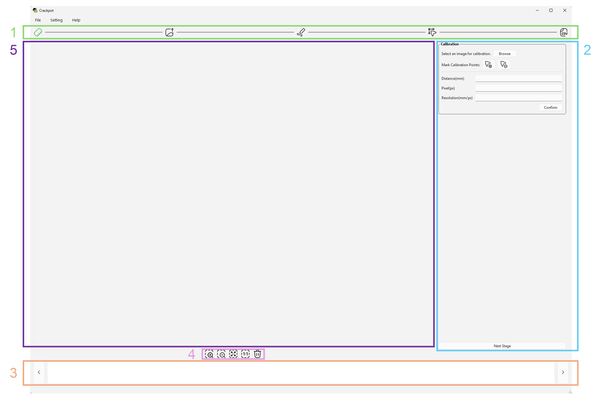
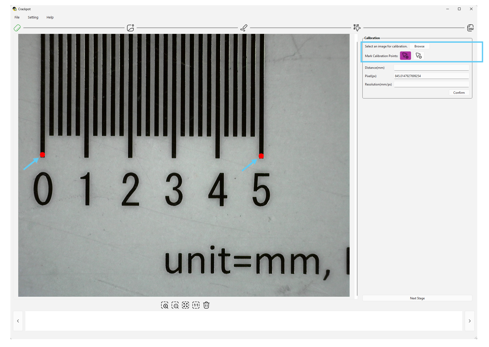
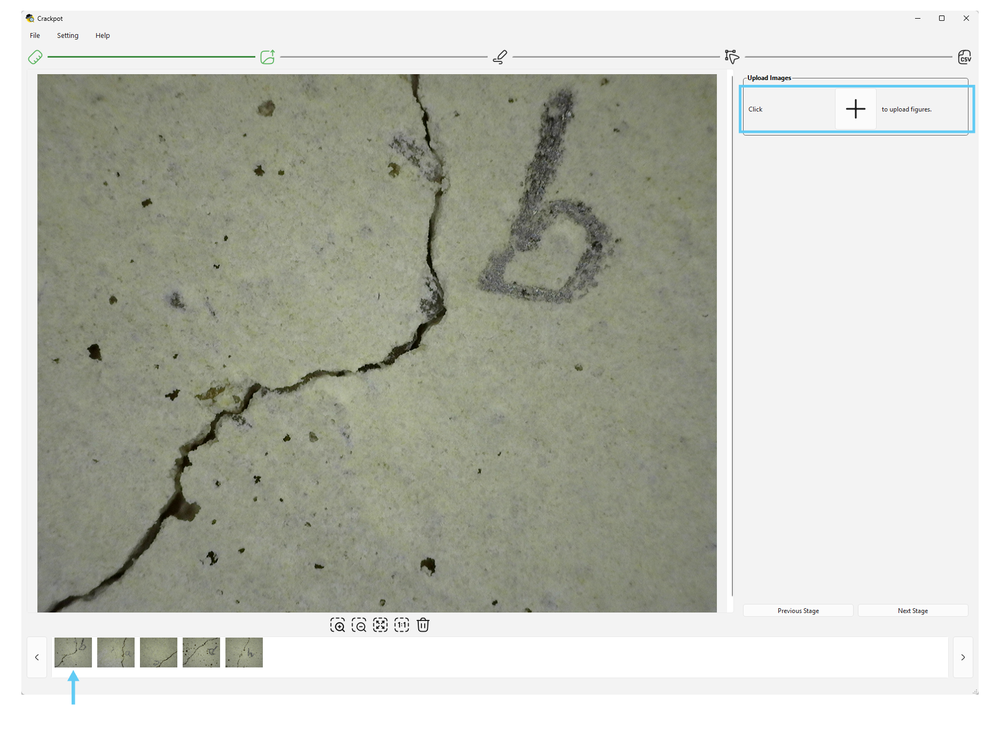
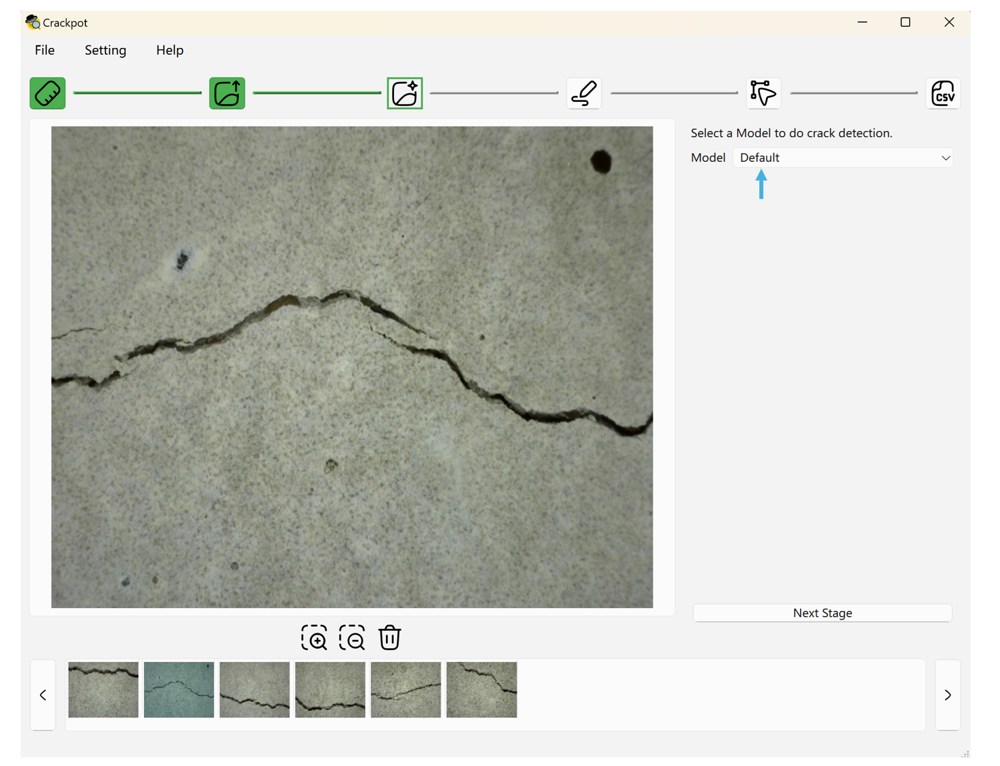
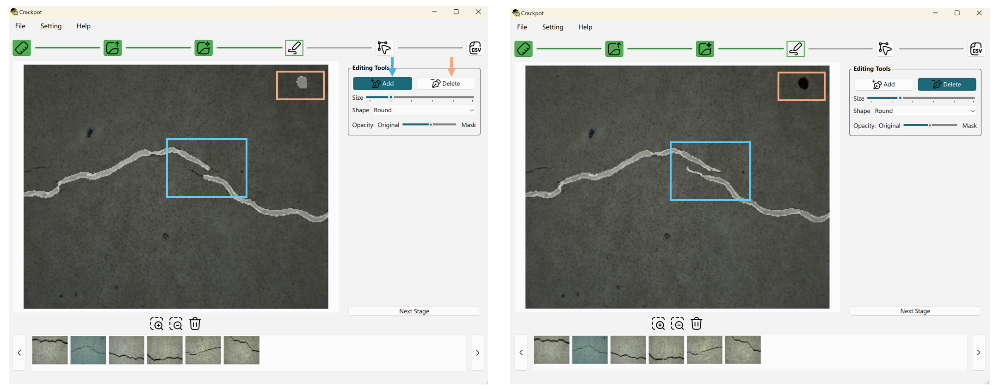
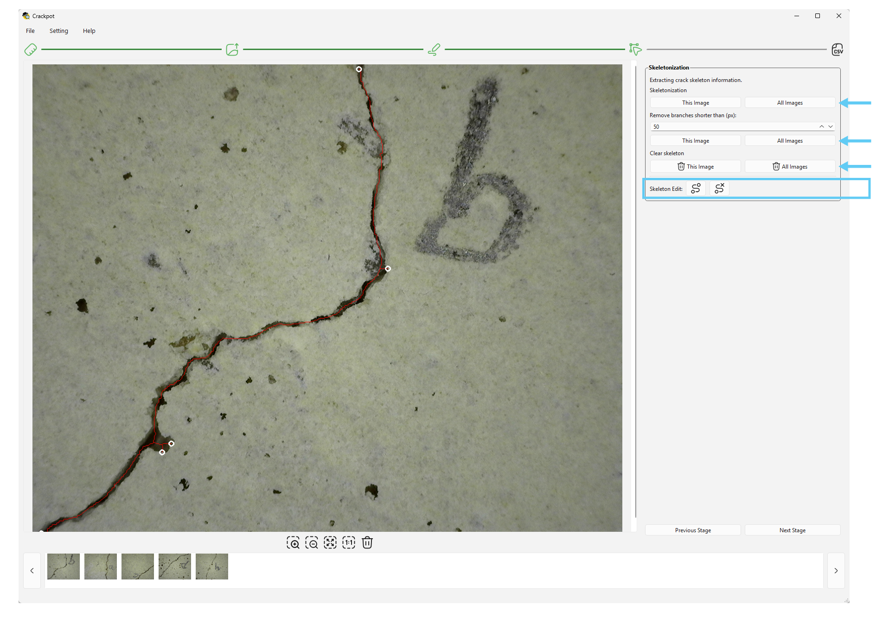
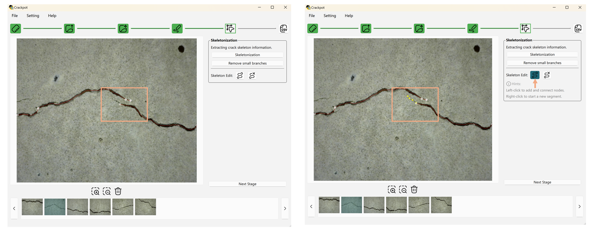

# Crackpot – Concrete Research And Crack Knowledge Photogrammetric Observation Tool


## Einführung

Dieses Projekt zielt darauf ab, Risseigenschaften automatisch aus Fotografien von Rissen zu extrahieren.
Es unterstützt die Stapelverarbeitung von Bildern in mehreren Stufen,
mit Fokus auf Rissbereichserkennung, Extraktion des Rissskeletts und Berechnung der mittleren Rissbreite auf Basis der kalibrierten Auflösung.
Manuelle Bearbeitungswerkzeuge stehen an bestimmten Stufen zur Verfügung, wo eine Nachbearbeitung der automatisierten Ergebnisse nötig ist.

Der Arbeitsablauf besteht aus folgenden Stufen:
- [Kalibrierungsstufe](#kalibrierungsstufe)
- [Bild-Upload-Stufe](#bild-upload-stufe)
- [Maskierungsstufe](#maskierungsstufe)
- [Skelettextraktionsstufe](#skelettextraktionsstufe)
- [Ergebnis-Export-Stufe](#ergebnis-export-stufe)


## Aufbau der Benutzeroberfläche

Die Benutzeroberfläche besteht aus fünf Hauptteilen:

1. **Obere Fortschrittsanzeige**: Zeigt die aktuelle Stufe innerhalb des Arbeitsablaufs an.
Fünf Symbole entsprechen den fünf zuvor beschriebenen Stufen.
   - Weiße Symbole stehen für nicht abgeschlossene Stufen.
   - Grüne Symbole zeigen abgeschlossene Stufen an.
   - Ein grün umrandetes Symbol markiert die aktuell aktive Stufe.

2. **Rechtes Werkzeugpanel**: Stellt die verfügbaren Werkzeuge und Aktionen für jede Stufe bereit.

3. **Unterer Vorschaubilder-Browser**: Zeigt Vorschaubilder aller geladenen Bilder an.
Das Hauptbild kann durch Klicken auf ein Vorschaubild oder über die Navigationsschaltflächen gewechselt werden.

4. **Mittlere Werkzeugleiste für Bildaktionen**: Bietet Werkzeuge zum Hinein- und Herauszoomen, zum Einpassen des Bildes in den sichtbaren Bereich, zum Zurücksetzen der Ansicht auf die native 1:1-Auflösung sowie zum Löschen des aktuell angezeigten Bildes.
   - **An Fenster anpassen** (`Strg+0`): skaliert das Bild so, dass es vollständig in den sichtbaren Bereich passt, unter Beibehaltung des Seitenverhältnisses.
   - **1:1** (`Strg+1`): zeigt das Bild in seiner nativen Auflösung, bei der ein Bildpixel einem Bildschirmpixel entspricht, nützlich für pixelgenaue Prüfung und Markierung.
   - **Scrollen zum Zoomen**: `Strg` gedrückt halten und mit dem Mausrad oder Trackpad über dem Bild scrollen, um um den Bildmittelpunkt herum hinein- und herauszuzoomen.

5. **Hauptbereich für Bildanzeige und -bearbeitung**: Der zentrale Bereich der Oberfläche dient der Anzeige und Bearbeitung des ausgewählten Bildes.


> Die UI-Symbole stammen von [Huge Icons](https://icon-sets.iconify.design/hugeicons/)
und sind unter der [MIT-Lizenz](../license/icon_MIT_LICENSE.txt) lizenziert.




## Kalibrierungsstufe

Diese Stufe berechnet die für die weitere Analyse benötigte Auflösung (Millimeter pro Pixel).
Ist die Auflösung bereits bekannt, kann sie direkt in das Auflösungsfeld eingetragen und bestätigt werden.
Andernfalls kann die Auflösung durch das Hochladen eines Bildes (z. B. eines Lineals oder Referenzobjekts) kalibriert werden.

Bei der bildbasierten Kalibrierung steht im rechten Werkzeugpanel ein Werkzeug zur Auswahl von Kalibrierpunkten zur Verfügung.
Durch die Auswahl zweier Punkte auf dem hochgeladenen Bild berechnet die Software automatisch die Anzahl der Pixel zwischen diesen Punkten.
Nach Eingabe des tatsächlichen physischen Abstands zwischen diesen Punkten wird die Auflösung automatisch berechnet.

> Beim Hochladen eines Bildes bitte sicherstellen, dass der Dateipfad keine Sonderzeichen wie `ü`, `ö`, `ä` usw. enthält, da dies zu Upload-Fehlern führen kann.



## Bild-Upload-Stufe

In dieser Stufe können die zu analysierenden Bilder stapelweise hochgeladen werden.
Nach dem Hochladen erscheinen alle Bilder als Vorschaubilder im Browser am unteren Rand der Oberfläche.
Ein Klick auf ein Vorschaubild zeigt das zugehörige Bild in voller Größe im Hauptanzeigebereich an.

> Beim Hochladen eines Bildes bitte sicherstellen, dass der Dateipfad keine Sonderzeichen wie `ü`, `ö`, `ä` usw. enthält, da dies zu Upload-Fehlern führen kann.




## Maskierungsstufe

Diese Stufe verbindet automatische Risserkennung mit manueller Maskenbearbeitung, da Erkennungsergebnisse
ohnehin meist manuell nachbearbeitet werden müssen. Jedes hochgeladene Bild startet mit einer leeren, direkt
bearbeitbaren Rissmaske; optional kann zusätzlich ein Modell darauf angewendet werden.

**Modellauswahl und Erkennung:**

- Eine Erkennungsmethode aus dem Dropdown-Menü auswählen — **Concrete Crack Segmentation** (Standard) verwendet das Modell
  von [Concrete Crack Segmentation](https://github.com/Subham2901/Concrete_Crack_Segmentation), lizenziert
  unter der [MIT-Lizenz](../license/model_MIT_LICENSE.txt); **None** lässt die Maske leer für
  eine vollständig manuelle Markierung.
- **Modell anwenden**: führt die ausgewählte Erkennungsmethode aus und überschreibt die aktuelle Maske mit dem Ergebnis.
  Verfügbar als zwei Schaltflächen: **Dieses Bild** wendet es nur auf das aktuell angezeigte Bild an, **Alle Bilder**
  wendet es auf jedes hochgeladene Bild an (Stapelverarbeitung). Bei ausgewähltem **None** setzt dies die Maske stattdessen
  auf leer zurück, statt ein Modell auszuführen.
- **Maske leeren**: setzt die Maske wieder auf leer zurück, sodass sie manuell neu aufgebaut werden kann. Ebenfalls verfügbar für **Dieses Bild**
  oder **Alle Bilder**.



**Manuelle Bearbeitungswerkzeuge** zur Nachbearbeitung der Maske (automatisch erkannt oder von Hand gezeichnet):

- Pinsel: Hinzufügen-Pinsel & Löschen-Pinsel
- Pinselgröße
- Pinselform: Rund (Standard) & Eckig
- Deckkraft-Schieberegler: Erlaubt die Anpassung der Transparenz, um das Originalbild (0 %) mit der Rissmaske (100 %) zu vergleichen.
- **Flecken kleiner als entfernen (px)**: entfernt kleine, unzusammenhängende Maskenbereiche (Standard 50 px), bei denen es sich
wahrscheinlich um Segmentierungsrauschen statt echter Risse handelt. Wie die Skelett-Aktionen weiter unten als zwei Schaltflächen verfügbar —
**Dieses Bild** und **Alle Bilder**.

Der Pinsel-Cursor zeigt die tatsächliche Pinselgröße und -form als Vorschau an und skaliert mit dem aktuellen Zoomfaktor mit, sodass der hervorgehobene Bereich immer dem tatsächlich gezeichneten Strich entspricht, auch bei kleinen Pinselgrößen oder hohem Zoomfaktor.



## Skelettextraktionsstufe

In dieser Stufe stehen drei Skelett-Aktionen zur Verfügung:

- **Skelettierung**: extrahiert die Skelettstruktur der erkannten Risse aus der Rissmaske.
- **Äste kürzer als entfernen (px)**: bereinigt das extrahierte Skelett, indem kurze
Äste automatisch entfernt werden. Der Längenschwellwert wird im Eingabefeld oberhalb der Schaltflächen festgelegt: jeder Ast, der kürzer als
diese Pixelanzahl ist, wird entfernt. Der Standardwert ist 50 px; der Wert gilt für beide Schaltflächen und bleibt wirksam, bis
er geändert wird.
- **Skelett leeren**: verwirft das extrahierte Skelett und setzt es auf einen leeren Zustand zurück, sodass es neu erzeugt
oder von Grund auf bearbeitet werden kann.

Jede dieser Aktionen ist als zwei nebeneinanderliegende Schaltflächen verfügbar: die linke (**Dieses Bild**) wirkt nur auf das
**aktuell angezeigte Bild**, während die rechte (**Alle Bilder**) auf **alle hochgeladenen Bilder gleichzeitig** wirkt
(Stapelverarbeitung). Dadurch lässt sich entweder jedes Bild eines Stapels verarbeiten oder die
Bilder einzeln nachbearbeiten und korrigieren — zum Beispiel Äste bereinigen oder ein Skelett für ein einzelnes Bild verwerfen, ohne
die anderen zu beeinflussen.




Während der Skelettextraktion und des Entfernens kleiner Äste können mitunter größere Skelettstrukturen verloren gehen.
Daher stehen manuelle Anpassungswerkzeuge zur Verfügung, um bei Bedarf Korrekturen und Ergänzungen vorzunehmen.
Diese Werkzeuge können auch eigenständig genutzt werden, ohne zuvor die automatische **Skelettierung** auszuführen, sodass ein Skelett vollständig von Hand erstellt werden kann, wenn das automatische Ergebnis nicht geeignet ist oder ein vollständig manueller Arbeitsablauf bevorzugt wird.

Zu den verfügbaren Skelett-Bearbeitungswerkzeugen gehören:

- **Skelettpunkt hinzufügen**: Nach Auswahl dieses Werkzeugs erzeugt ein Klick auf das Bild einen Skelettpunkt.
Ein zweiter Klick an einer anderen Stelle verbindet die beiden Punkte automatisch und bildet eine Skelettlinie zwischen ihnen.
Um ein neues, unabhängiges Skelettsegment zu beginnen, ohne es mit dem vorherigen Punkt zu verbinden, an der gewünschten Stelle rechtsklicken, um einen unverbundenen Skelettpunkt zu erzeugen.

- **Skelettpunkt entfernen**: Ein Klick auf einen bestehenden Skelettpunkt löscht diesen Punkt.
Lag der Punkt zwischen zwei anderen, werden diese beiden direkt verbunden, sodass die Linie zusammenhängend bleibt.
Ein Klick auf eine Skelettlinie löscht stattdessen diese Linie.
Eine von Hand gezeichnete Linie verschwindet zusammen mit jedem ihrer Endpunkte, der danach an keiner anderen Linie mehr hängt.
Beim automatisch extrahierten Skelett wird das Stück zwischen den beiden nächstgelegenen Verzweigungen bzw. losen Enden entfernt.

> Da die Skelettextraktion auf der in der vorherigen Stufe gewonnenen Rissmaske basiert, wird empfohlen, die Rissbereiche
in der Rissbereichserkennungsstufe gut nachzubearbeiten und zu bereinigen. Dies führt zu einem besseren extrahierten Skelettergebnis.





## Ergebnis-Export-Stufe

Nach Abschluss der vorherigen Schritte zeigt die letzte Stufe die Analyseergebnisse auf Basis der erkannten Rissmasken, extrahierten Skelette und der kalibrierten Auflösung an.

Die Oberfläche zeigt für jedes Bild:
- Dateiname
- Rissfläche
- Skelettlänge
- Mittlere Rissbreite

Eine Exportfunktion ermöglicht den Stapelexport dieser Ergebnisse in eine `.csv`-Datei durch Auswahl eines Zielpfads.


Nach Abschluss der Analyse setzt ein Klick auf die Schaltfläche **Fertig** die aktuellen Ergebnisse zurück und bringt den Arbeitsablauf zur Ausgangsstufe zurück, bereit für eine neue Analyserunde.

Muss während des Prozesses eine Stufe angepasst werden (z. B. zusätzliche Bilder hochladen, die Rissmaske anpassen oder das Skelett nachbearbeiten), kann durch Klicken auf die Fortschrittsanzeige am oberen Rand der Oberfläche zur entsprechenden Stufe zurückgesprungen werden.

> Nach der Rückkehr zu einer vorherigen Stufe und dem Vornehmen von Änderungen wird empfohlen, alle nachfolgenden Stufen erneut auszuführen, um sicherzustellen, dass die Ergebnisse korrekt aktualisiert werden.
Ein direkter Sprung zur letzten Stufe ohne erneute Ausführung der Zwischenstufen kann zu inkonsistenten oder veralteten Ergebnissen führen.
Bitte nach jeder Änderung stets der Reihenfolge des Arbeitsablaufs folgen.


### Wie die Skelettlänge gemessen wird

Das Skelett ist eine Linie von einem Pixel Breite.
Es liegt nahe, seine Pixel zu zählen und diese Anzahl als Länge zu verwenden.
Dieses Vorgehen unterschätzt die tatsächliche Länge jedoch deutlich.
Wie groß die Abweichung ausfällt, hängt von der Richtung ab, in die der Riss verläuft.

Eine schräge Linie wird auf dem Pixelraster als Treppe abgebildet.
Ein Schritt über die Diagonale überbrückt dabei etwa 1,41 Pixel, zählt aber nur als ein einzelner Schritt.
Bei einem Riss unter 45 Grad fehlen auf diese Weise fast 30 % der Länge.
Verläuft der Riss entlang einer Zeile oder Spalte, stimmt die Zählung, und dazwischen liegt der Fehler zwischen diesen beiden Werten.

Crackpot zählt die Pixelkette deshalb nicht, sondern misst sie.
Jeder Schritt wird danach gewichtet, wie weit er tatsächlich reicht, und die Anzahl der Richtungswechsel wird von der Summe abgezogen:

```
Länge = 0,980 * gerade Schritte + 1,406 * diagonale Schritte - 0,091 * Ecken
```

Die beiden Schrittgewichte liegen etwas unter ihren geometrischen Werten von 1 und 1,4142.
Verantwortlich dafür ist erneut die Treppe, denn sie ist länger als die Linie, die sie darstellt.
Sie verläuft an zwei Seiten eines Dreiecks entlang statt an der Hypotenuse.
Wie viel Treppe eine Kette enthält, lässt sich an der Anzahl ihrer Richtungswechsel ablesen, und genau dafür steht der dritte Term.

Die drei Gewichte sind so aufeinander abgestimmt, dass sich der verbleibende Fehler über alle Richtungen hinweg aufhebt.
Für die Messung eines Risses ist das entscheidend, da er viele Richtungen durchläuft.
Nur ein Fehler, der sich im Mittel aufhebt, summiert sich entlang seines Verlaufs nicht auf.
Im Gegenzug wird der Sonderfall der exakt achsparallelen Linie ungenauer und um etwa 2 % zu kurz gemessen.
In der Praxis fällt das kaum ins Gewicht, da ein realer Riss dem Raster nur selten über längere Strecken folgt.

Angegeben wird die Gesamtlänge aller Linien des aufgeräumten Skeletts einschließlich der Seitenäste, nicht die Länge seines längsten Weges.
Die mittlere Rissbreite wird daraus als Rissfläche geteilt durch Skelettlänge berechnet.
Beide Angaben beziehen sich damit auf dieselben Linien.

Die verwendeten Gewichte gehen auf Vossepoel und Smeulders (1982) zurück, die damit den Kettencode nach Freeman (1961) korrigieren.
Eine ausführlichere Gegenüberstellung der Verfahren findet sich bei Cris Luengo unter <https://www.crisluengo.net/archives/310/>.


## Sitzung speichern und fortsetzen

Die Bearbeitung eines großen Bilderstapels muss nicht in einem Durchgang erfolgen.
Das **Datei**-Menü bietet zwei Aktionen, um eine laufende Sitzung zu speichern und später fortzusetzen:

- **Projekt exportieren...**: Speichert die aktuelle Sitzung — die Liste der hochgeladenen Bilder, die Kalibrierungsauflösung,
alle erkannten/bearbeiteten Rissmasken und alle Skelettdaten (einschließlich manuell hinzugefügter Skelettpunkte und -linien) —
in einer einzelnen `.crackpot`-Projektdatei. Die hochgeladenen Bilder selbst werden dabei **nicht** in diese Datei kopiert, sondern nur
über ihren Dateipfad referenziert, sie müssen also unter demselben Pfad verfügbar bleiben, um später wieder geladen werden zu können.
- **Projekt importieren...**: Lädt eine zuvor gespeicherte `.crackpot`-Datei und stellt den genauen Arbeitsstand wieder her,
einschließlich der aktuellen Stufe, sodass die Arbeit genau dort fortgesetzt werden kann, wo sie unterbrochen wurde. Ist ein Bild unter
seinem ursprünglichen Pfad nicht mehr auffindbar, wird es übersprungen und in einer Warnmeldung aufgeführt, während der Rest des Projekts
trotzdem normal geladen wird.

## Software-Stack
- Backend/Logik: Python3
- Frontend: Qt6/PySide6

## Autoren
Bertram Richter, Carl Stock und Xiaoli Song
